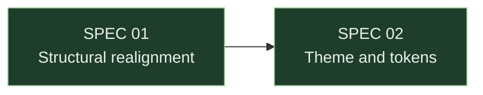

# State-board recipes

How to render each placeholder in `STATE.template.md`. Unlike `section-recipes.md` — which is
Socratic, because a spec precedes its code and there is nothing to autodiscover — most of this
file is **mechanical**: the board is derived from the spec files, so almost nothing here is a
question for the user.

Two classes of block, separated by the `<!-- spec-state:generated:start -->` /
`<!-- spec-state:generated:end -->` markers:

- **GENERATED** — rebuilt in full, every time, from the spec files. Never patch a single row by
  hand: re-derive the whole block. If a row disagrees with its file, the file wins.
- **NARRATIVE** — written by hand and **preserved verbatim** across regenerations. Read the
  existing text, keep it, and only extend it when the user has something new to say.

**Language.** Headings follow the language the repo's existing specs are written in (default
English, like `SPEC.template.md`). The **Status tokens are always canonical English** —
`Draft`, `In review`, `Approved`, `Implemented`, `Obsolete` — exactly as they are normalized
inside each spec file, so the board stays parseable no matter what language the conversation
happened in. The marker comments are never translated.

---

## Where the data comes from

Everything in the generated block comes from two header lines of each
`<specs-dir>/SPEC-NN-*.md`, plus the presence of one section:

```
> **Status:** Implemented — PR #123
> **Depends on:** SPEC 02, SPEC 04
```

| Datum | Source |
|---|---|
| `NN` and title | Filename + the `# SPEC NN — Title` heading |
| Status token | `> **Status:**` — the first word(s) before any `—` |
| Ref | The remainder after the `—` on the Status line (`PR #123`, a commit SHA); `—` when absent |
| Depends on | `> **Depends on:**` |
| Open questions | Whether `## Open questions` exists and has content |

Never invent a Ref. The column exists to carry what **bambu-spec-implement** already wrote on
the Status line at handoff — if that line has no reference, the cell is `—`.

---

## `{{BOARD_TITLE}}` — GENERATED

`Spec status board` (or its Spanish equivalent, `Estado de los SPECs`, when the repo's specs
are in Spanish). Nothing clever — the file is found by name, not by its title.

---

## `{{DATE}}` · `{{BRANCH}}` · `{{COMMIT}}` — GENERATED

Today's date (`YYYY-MM-DD`), plus `git rev-parse --abbrev-ref HEAD` and
`git rev-parse --short HEAD`. In a repo without git, write `—` for branch and ref rather than
dropping the line: the board claims to be a snapshot, so it has to say of what.

---

## `{{STATUS_ROWS}}` — GENERATED

> **This row shape is the canonical definition, and it is mirrored.** `bambu-spec-implement`
> repeats it inline in its handoff step — it writes one row (Status + Ref) at the end of an
> implementation and can't be made to depend on this file, since the two skills install
> separately. If the columns ever change, change them in both places.

One row per spec file, ordered by `NN` ascending, **including Obsolete ones** — a number is
never recycled, so a gap in the table means a lost file, not a retired spec.

```
| 04 | [Shell and hero in Server Components](SPEC-04-shell-and-hero.md) | ✅ Implemented | SPEC 02, SPEC 03 | `ecc421a` |
| 09 | [Cookieless analytics](SPEC-09-analytics.md) | 📝 Draft | SPEC 07 | — |
| 13 | [Stack as concentric layers](SPEC-13-stack-layers.md) | 🗃️ Obsolete — superseded by SPEC 16 | SPEC 06, SPEC 12 | — |
```

- The Spec cell is a relative markdown link to the file, so the board works on GitHub and in an
  editor alike.
- Emoji: 📝 Draft · 👀 In review · 🟢 Approved · ✅ Implemented · 🗃️ Obsolete. The emoji is
  decoration in front of the canonical token; it never replaces it.
- An Obsolete row carries its reason inline, copied from the Status line.
- `Depends on` is copied verbatim, not renumbered or abbreviated. `—` when empty.

---

## `{{SUMMARY_COUNTS}}` — GENERATED

One line, counts for all five states, implemented first because that is the number people look
for:

```
21 of 28 implemented · 5 Draft · 0 in review · 2 approved · 0 obsolete.
```

---

## `{{READY}}` — GENERATED

The specs whose Status is `Approved` **and** every entry in their `Depends on:` is `Approved`
or `Implemented`. That is exactly the precondition `bambu-spec-implement` re-checks before it
starts, so this list answers "what can I build right now" without opening a file.

```
- **SPEC 10** — [LCP budget and font preloading](SPEC-10-lcp-budget.md) · deps: SPEC 06 ✅
```

When the list is empty, write one line saying why in the aggregate — `Nothing approved yet;
the three Drafts have to clear review first.` — not a bare `—`. An empty board section that
does not explain itself reads like a rendering bug.

---

## `{{BLOCKED}}` — GENERATED

Two kinds, each with its blocker named. Both are derivable; neither is a judgment call.

1. **Dependency-blocked** — any non-Implemented spec with a `Depends on:` entry that is not
   yet Approved/Implemented.
2. **Approval-blocked** — any spec in `In review` whose `## Open questions` section is still
   non-empty. The skill's own gate refuses Approved while that is true, so the board says it
   out loud.

```
- **SPEC 27** — blocked by SPEC 26 (📝 Draft)
- **SPEC 09** — 2 open questions pending; cannot reach Approved
```

Same rule as above when empty: say `Nothing blocked.`, not `—`.

---

## `{{CRITICAL_PATH}}` — GENERATED

The longest dependency chain that ends in a spec that is **not** Implemented — the sequence
that actually gates finishing. Render it as arrows plus how much of it is left:

```
`01 → 02 → 04 → 05 → 07 → 09` — 1 level left (SPEC 09).
```

If every spec is Implemented, write `All specs implemented; no path left.` If several chains
tie for longest, show the one with the most non-Implemented specs on it, and mention the tie
in one clause.

---

## `{{ASCII_GRAPH}}` — GENERATED

Always rendered — it is the part that survives being read in a terminal, a diff, or a commit
message. Two shapes, used together, because a real spec graph is a tree only at the beginning:

```
01 ─┬─ 02 ─┬─ 04 ── 05 ─┬─ 06 ── 10
    └─ 03 ─┘            ├─ 07 ── 09
                        └─ 08

11 ← 03 + 04 + 05 + 07   (converges: replaces the MOCK data with the real content)
12 ← 05 + 06 + 11        (redoes the stack section as a single table)
```

- Draw the tree for the single-parent spine.
- Any spec with **two or more** dependencies gets its own `NN ← A + B + C` line below, with a
  parenthetical of at most one line saying what it does. Forcing a converging node into ASCII
  branch art is what makes these diagrams wrong.
- Group the lines in blocks separated by a blank line when a set of specs forms one initiative
  (e.g. an i18n chain); the blank line is the only grouping device available here, so use it.

---

## `{{MERMAID_GRAPH}}` — GENERATED, conditional

Render the fenced `mermaid` block only when the graph is big enough to earn it: **6 or more
specs, or at least one spec with 2+ dependencies**. Below that the ASCII graph already shows
everything and a Mermaid block is boilerplate — omit it entirely, leaving no empty fence.



- Node id `S<NN>`, label `SPEC NN<br/>short title` (shorten the title; the full one is already
  in the table).
- One edge per dependency, `dep --> spec`.
- **One `class` line per status, listing every member**, rebuilt from scratch each time. Never
  append `class S24 done;` to the end — a per-spec line is how these blocks drift until two
  lines claim the same node.
- Omit the `class` line of any status with no members, but keep all five `classDef`s so the
  next regeneration doesn't have to reinvent the palette.

---

## `{{NARRATIVE}}` — NARRATIVE, preserved

Prose under `## Reading the board`: what the table cannot say. Where the work actually stands,
why something has been stuck for three weeks, which decision is not worth reopening, what a
spec measured that the next one should not re-measure.

- **Preserve it verbatim on every regeneration.** Read it first, write it back unchanged.
- **Never restate the generated block here.** "SPEC 09 is Draft" is already a row; "SPEC 09 has
  been Draft since the analytics vendor question went unanswered" is the reason the section
  exists.
- When the user has nothing to add, leave whatever is there. On a brand-new board, seed it with
  a single honest sentence about the current state rather than a placeholder.

---

## `{{PROJECT_NOTES}}` — NARRATIVE, preserved, OPTIONAL

An appendix for the durable, project-specific facts that several specs keep referring to: a
performance budget and where it is measured, contracts already closed by an implementation,
known debt and which spec owns it, decisions settled at approval time.

Omit the entire section — heading and placeholder both — when there is nothing of the sort.
Like every OPTIONAL section in this skill, it is dropped rather than filled with boilerplate.
If it survives, it is preserved verbatim exactly like `{{NARRATIVE}}`.

---

## Regenerating an existing board

1. Read the current `STATE.md` and keep everything **after** `spec-state:generated:end`.
2. Re-derive the generated block from the spec files — all of it, not the rows that changed.
3. Write the file back: header, fresh generated block, preserved narrative.
4. Run `scripts/state-check.sh` and report what it says.

If the markers are missing (a hand-written board that predates this template, like the one this
feature was distilled from), do not guess where the boundary was: show the user the generated
block you would write, ask which existing prose belongs under `## Reading the board`, and only
then replace the file.
